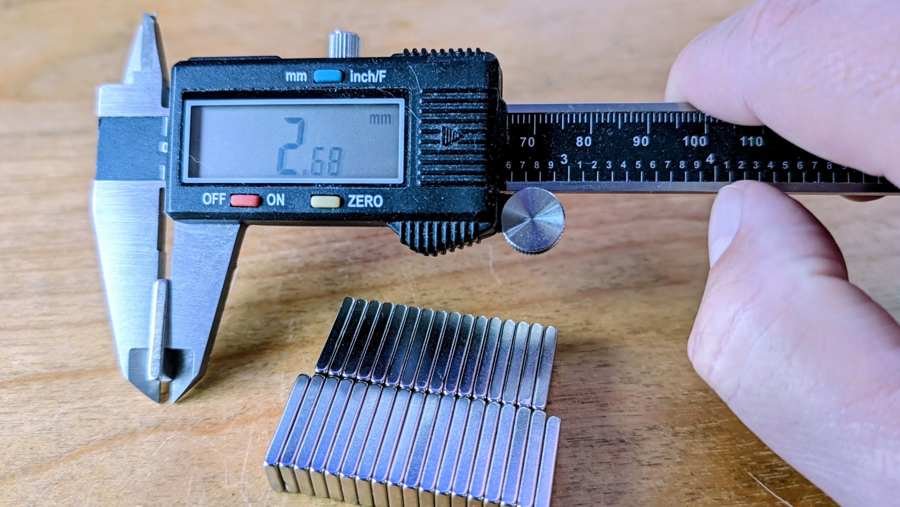
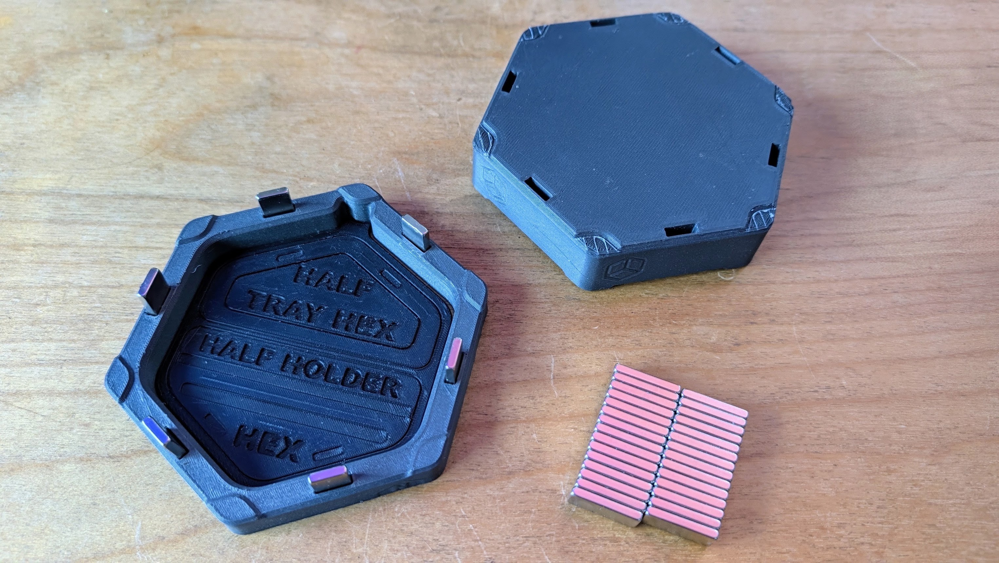

# Taking 3D Printed Products to Market (Part 2: Hardware Sourcing, Slicing, and Shop-Floor QC)

In Part 1, I laid out the direct-to-retail hypothesis: **Can an independent designer-led 3D product build a sustainable, recurring revenue business on Etsy using on-demand fulfillment?**

Today, I am leaving the theory behind and stepping onto the shop floor. 

A clean CAD render or slick Kickstarter video looks effortless. But turning a multi-part, magnetic gameplay organizer like NeedItMakeIt's Hexstora into a repeatable, commercial physical product is where reality sets in. 

If you want customers to happily pay $20 for a single tray or $80+ for a complete starter set, you cannot just slap a default 0.28mm draft profile on a machine and throw raw plastic into a padded envelope. You have to solve three real manufacturing bottlenecks:
1. Sourcing hardware "sugar" (magnets) without destroying your margins.
2. Optimizing slicing profiles and build plates for small-fleet throughput.
3. Eliminating assembly problems before you ruin parts or waste hours of touch labor.

Here is the pre-production data, slicing metrics, and shop-floor lessons from getting my launch SKUs ready for production.

## 1. The Magnet Sourcing Reality (20x10x3mm Magnets)

Modular magnetic products feel amazing in the hand. That tactile snap is part of what justifies a premium retail price tag. But for my 5-piece Starter Pack, each bundle requires **22 rectangular magnets** (6 per tray across 3 trays, plus 2 per half-card holder across 2 holders).

Sourcing 22 magnets per product reveals an eye-opening price curve:

- **Amazon Retail Packs (10 to 20 pcs):** $0.80 to $1.10 each with fast Prime delivery. Great for weekend prototyping, but on a 22-magnet bundle, that represents $17.60 to $24.20 in magnets alone. It instantly obliterates your profit margins.
- **AliExpress Intermediate Batches (50 to 100 pcs):** $0.30 to $0.45 each. Delivery takes 7 to 12 days, but cuts hardware BOM down to ~$7.70 per bundle.
- **Factory-Direct RFQ / Alibaba (500+ pcs):** $0.15 to $0.25 each. Requires upfront capital and longer lead times, but drives magnet cost to ~$4.40 per bundle.

**The Production Pricing Model ($0.50/ea):** In my cost model, I established a standardized bill of materials (BOM) allowance of **$0.50 per magnet** ($11.00 total for the 5-piece set). If a print farm operator sources them for $0.30 or $0.20 through bulk purchasing, they keep the difference as an efficiency bonus.

**The Tolerance Trap:** Inexpensive magnets often vary in dimensional tolerance (+/- 0.1mm to 0.2mm). A magnet pocket modeled at exactly 3.0mm will bind or crack the print if a 3.15mm magnet arrives, or rattle loosely if it measures 2.85mm. Designing with a 0.15mm tolerance margin is essential for reliable press-fits.

The designers received feedback about the issue from the community and released models with 3 different tolerances to address the issue. While that helped, it now complicates production: it is anyone's guess if the current batch of magnets will fit well (or at all). Worse yet, I have to pre-process all models in the slicer 3 separate times.

## 2. Model Prep & Slicer Optimization (Variable Layer Height & Support Tuning)

I run a small fleet of 3 desktop FDM printers (Snapmaker U1 & Voron class). When machine capacity is constrained, slicing parameters can really influence your production throughput.

The designers recommended printing with a default 0.16mm layer height, which would have resulted in **6.5 hours of print time** for a full batch. By investing time to tune slicing parameters, I found a significantly better balance:

- **Variable Layer Height:** Instead of printing every single layer at 0.16mm, I leveraged adaptive variable layer heights: tightening down to 0.12mm to 0.16mm on areas of the model that benefit from extra resolution, while ramping up to 0.20mm to 0.24mm on straight vertical walls and dense bases to decrease print time.
- **The Throughput Win:** This optimization cut total print time from **6.5 hours down to 5.5 hours** per plate (shaving a full hour per batch) while actually improving surface finish and tactile quality where it matters most.

### The Support Headache & Magnet Blockers

No design is completely immune to manufacturing friction. The Hexstora tiles include an overhang feature that requires small supports:
- **Auto-Support Failure:** Slicer auto-generation aggressively placed supports inside the tight magnet pockets, which would have been nearly impossible to clean out without damaging the press-fit walls.
- **Manual Prep Work:** I had to manually paint support blockers across all 22 magnet holes in the project file, restricting supports strictly to the necessary structural overhangs.
- **Post-Processing Trade-off:** Even with carefully tuned support Z-distance, I still have to manually pluck out small support remnants during post-processing. Supported surface finish naturally suffers slightly compared to bare build plates, though fortunately, this feature is hidden on a non-visible mating surface.

### Slicing & Support Rules of Thumb
- **For Designers:** Think like a print farm where Print Time = Money!
	- Spend the time to optimize slicing parameters, keep customizations minimal and as generic as possible, and save as a 3MF to share across printers.
	- Add support blockers to ensure supports are used only where essential.
	- Run your own test prints to ensure quality meets your standards.
	- Share the optimized 3MF along with a generic project file for production (some farms may need to re-slice).
- **For Print Farm Operators:** Spend the time to optimize slicer settings: you can save print time and preserve quality using variable layer height where it matters most.

## 3. The Assembly Dry Run & The Polarity Jig

Manual touch labor is the silent killer of 3D print margins!

On my first dry run, I tried inserting 22 magnets by hand, checking polarity with a loose reference magnet for each pocket:
- **The Failure Mode:** It took 12 full minutes per set. Even worse, on one tray, a magnet flipped during insertion and got mounted backwards, permanently ruining the printed part.
- **The Solution:** I spent 30 minutes designing and printing a dedicated **magnetic polarity alignment jig** and press block. The jig holds the tray firmly and physically prevents a magnet from entering the pocket unless the polarity matches.
- **The Impact on Labor:** Assembly time dropped from 12 minutes to **under 5 minutes flat**.
- **The Math:** I value shop-floor labor at a fair floor of **$25.00/hr ($0.416/minute)**. Shaving 7 minutes of manual labor saves **$2.91 in direct cash cost per unit**. Over 50 orders, that single 3D-printed jig saves nearly $150 in labor.

## 4. Shop-Floor QC & Packaging Protection

Before any unit is boxed, it must clear a strict 4-point quality checklist:
1. **Polarity Verification:** Snaps firmly to a master reference block across every active hex face.
2. **Flush Seating Check:** Magnets are seated below the surface so they never scratch polished wooden gaming tables.
3. **Modular Engagement:** Trays slide together smoothly with zero binding or scraping.
4. **Visual Finish:** Clean top surfaces, crisp seams, and zero corner warping.

**Packaging Drop-Test:** Tabletop gamers expect high-quality unboxing. I standardized on honeycomb paper wrap inside a rigid custom mailer box ($1.00 packaging BOM). I conducted three 4-foot drop tests onto concrete to verify that packaging would survive abuse during courier transit.

## 5. Pre-Production Investment & Scrap Tally

Before listing a single unit on Etsy, here is the honest accounting of prototype waste, machine time, and labor invested to dial in this product:

- **Material Waste & Prototype Tuning:**
	- 2 full 5-piece Starter Packs printed for slicing qualification: **586g PLA**
	- 4 individual test parts that failed QC (scrapped during tolerance tuning): **~220g PLA**
	- Total tuning filament consumed: **~800g PLA** (*~$20.00 at $25/kg*)
	- Hardware samples (Amazon Prime + AliExpress test magnet packs): **$18.50**
	- Sample rigid mailers & honeycomb wrap for drop-testing: **$4.00**
	- **Part 2 Direct Out-of-Pocket Sunk Cost:** **$42.50**

- **Fleet Machine Time:**
	- **~17.5 hours** of total FDM machine time logged across tuning plates and failed test pieces.

- **Hands-On Operator & Engineering Labor:**
	- Slicer tuning, variable layer height testing, and support painting: **3.0 hrs**
	- Printing, bed clearing, measuring tolerances, and QC inspection: **2.5 hrs**
	- Polarity alignment jig CAD design, print, and verification: **1.0 hr**
	- Packaging assembly and concrete drop-testing: **0.5 hrs**
	- **Part 2 Hands-On Labor Total:** **7.0 hours** (*$175.00 value at $25/hr floor*)

- **Running Series Total:** **$142.50 cash expenses** *(including $100 commercial license)* + **$212.50 labor value** *(8.5 hrs total @ $25/hr floor)* = **$355.00 Total Pre-Production Investment**

---

## Field Notes for Designers & Print Farms

- **For Designers & Creators:** Design with standard hardware tolerances in mind. A 0.2mm magnet pocket variance can turn a clean press-fit into loose rattling or broken prints. Designing for simple, single-orientation assembly drastically reduces labor bottlenecks and protects your product's retail reviews.
- **For Print Farm Operators:** Never assemble multi-part magnets by hand. Spend time printing a dedicated polarity jig; cutting assembly time from 12m to 5m saves nearly $3.00 per unit in labor at standard $25/hr rates. Batching the full 5-piece starter set on a single build plate (5.5h with variable layer height) unlocks high-margin, unattended overnight capacity.

**Discussion Question:** For those producing functional or multi-part 3D prints with hardware (magnets, heat-set inserts, fasteners), what custom jigs or assembly steps have saved you the most time on the shop floor?
