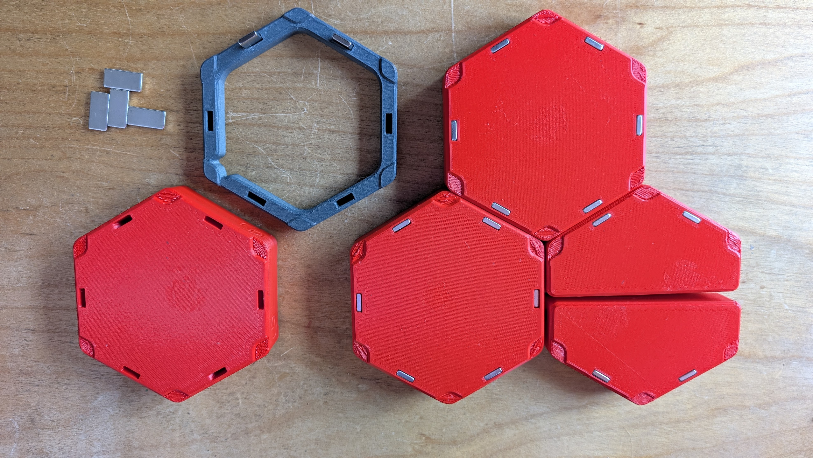
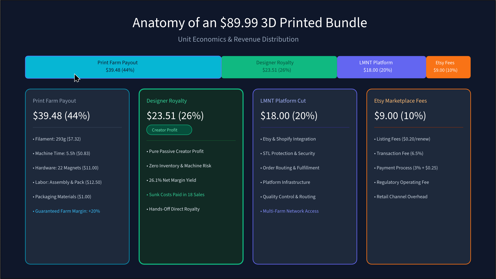

# Taking 3D Printed Products to Market (Part 4: The Real Cost of a 3D Print)

Most people starting an Etsy 3D printing shop use a pricing rule like `Filament Cost x 3`. 

That rule works fine until you calculate machine wear, electricity, labor time ($25/hr), packaging boxes, platform transaction cuts, and hardware components like magnets. Suddenly, an item that cost "$1.50 in plastic" loses money on every sale.

In this post, I'll break down the true cost per unit, including platform fees, minimums required to protect profits, and top line profit margin targets I used for the Hexstora product line.

## 1. The Production Cost Stack (Shop Floor Baselines)

I use standardized baselines to calculate true base production costs:
- **Filament:** $25.00/kg ($0.025 per gram) for standard PLA+/PETG.
- **Machine Rate:** $0.15/hour (covering electricity at $0.14/kWh, maintenance, and capital depreciation on a $1,000 printer).
- **Human Labor Rate:** $25.00/hour ($0.416/minute) for bed clearing, support removal, magnet insertion, and packing.
- **Hardware BOM:** $0.50 per 20x10x3mm bar magnet.
- **Packaging:** $1.00 flat allocation per shipment (box, poly mailer, protective wrap, and label).

## 2. Individual SKU Cost Breakdown

| Part Name              | Filament (g)  | Print Time     | Magnets   | Labor (Assembly+Pack)      | Base Production Cost | Print Service Payout if using POD (+20% Margin) |
| :--------------------- | :------------ | :------------- | :-------- | :------------------------- | :------------------- | :---------------------------------------------- |
| **Tri-Tray**           | 54.7g ($1.37) | 1h 34m ($0.24) | 6 ($3.00) | 10 min ($4.17) + $1.00 Box | **$9.78**            | **$11.74**                                      |
| **Split-Tray**         | 53.2g ($1.33) | 1h 17m ($0.19) | 6 ($3.00) | 10 min ($4.17) + $1.00 Box | **$9.70**            | **$11.64**                                      |
| **Full-Tray**          | 50.0g ($1.25) | 1h 12m ($0.18) | 6 ($3.00) | 10 min ($4.17) + $1.00 Box | **$9.61**            | **$11.53**                                      |
| **Half-Card (Single)** | 67.5g ($1.69) | 1h 34m ($0.24) | 2 ($1.00) | 10 min ($4.17) + $1.00 Box | **$8.10**            | **$9.72**                                       |

*Note: Print farms receive a guaranteed 20% service margin above raw production costs when using the LMNT POD service (e.g. $11.74 payout on a $9.78 base cost), ensuring operators make a clear profit on every unit.*

## 3. The Starter Pack 1 Bundle Advantage (5-Piece Set)

When bundling 1x Tri-Tray, 1x Split-Tray, 1x Full-Tray, and 2x Half-Cards into a single order, packaging overhead ($1.00 flat) and boxing labor consolidate:

- **Total Filament:** 292.9g ($7.32)
- **Total Machine Time:** 5.5 hours ($0.83) *(tuned down from 7h 11m via variable layer height in Part 2)*
- **Total Magnets:** 22 magnets ($11.00)
- **Total Labor:** 30 minutes ($12.50)
- **Packaging:** $1.00
- **Bundle Base Production Cost:** **$32.65**
- **Required Printer Payout (+20%):** **$39.48**

## 4. Retail Pricing Spectrum & Margin Yields

Where does the revenue go? Etsy fees, LMNT platform fees, and Print Farm payouts:

| Target Bundle Retail Price | Etsy Cut (~10%) | LMNT Split (20%) | Printer Payout | Designer Royalty / Reseller Yield | Margin % | Strategic Role                                           |
| :------------------------- | :-------------- | :--------------- | :------------- | :-------------------------------- | :------- | :------------------------------------------------------- |
| **$56.99**                 | $5.70           | $11.40           | $39.48         | **$0.41**                         | 0.7%     | **At-Cost Promotional Pricing**                          |
| **$69.99**                 | $7.00           | $14.00           | $39.48         | **$9.51**                         | 13.6%    | **Doorbuster Entry** (11 sales pays off $100 KS license) |
| **$79.99**                 | $8.00           | $16.00           | $39.48         | **$16.51**                        | 20.6%    | Competitive Bundle Price                                 |
| **$89.99**                 | $9.00           | $18.00           | $39.48         | **$23.51**                        | 26.1%    | **Realistic Designer Target**                            |
| **$99.99**                 | $10.00          | $20.00           | $39.48         | **$30.51**                        | 30.5%    | Premium Complete Box Set                                 |

## 5. The Competitive Reality Check: Internal Cost Models vs. Market Pricing (My #1 Mistake)

Here is the confession I teased in Part 1: **pledging $100 for a commercial Kickstarter license before conducting competitive pricing research was my single biggest mistake.**

Having a spreadsheet that cleanly calculates an **$89.99 retail price** to deliver a healthy 26.1% designer royalty ($23.51) and living print farm wages ($25/hr) is great. But none of that matters if the actual marketplace will not bear that price tag.

When I took a look at similar products on Etsy, the competitive landscape became clear:
- **Race-to-the-Bottom Pricing:** $8.50 to $9.00 for similar-looking, potentially lower-quality designs. This is typically a solo designer or small print studio not using print-on-demand or paying designer royalties.
- **Peer Competition:** $12.99 to $14.99 for similar non-magnetic trays, which we would charge $19 for (print-on-demand, with only an 11% designer royalty).
- **Game-Specific Organizers:** Organizers with high-end designs tailored to specific or popular games target the upper end of the range: $20 to $25 for individual organizers up to $80+ for complete sets.

### The Pricing Squeeze
Listing our 5-piece Starter Pack at $89.99 puts us at the very high end of the market:
- **Commodity Price Erosion:** You are never going to be able to compete directly on price when sellers devalue their time. They are not building a sustainable business, but a short-term side hustle, and when they need to scale beyond a solo endeavor, their prices have to rise.
- **You must deliver boutique craftsmanship:** That price point demands the tactile magnetic snap-fit experience, high-quality finish, and clean, drop-tested packaging I discussed in Part 2.
	- Leverage boutique print-on-demand services to stand out: being able to offer unique colors or premium finishes helps differentiate your listing from generic offerings.
- **The Discount Risk:** If early sales velocity forces you to discount down to the promotional floor of **$69.99**, the net designer royalty gets slashed from **$23.51 down to $9.51 per bundle**, and the number of sales needed to break even on pre-production R&D jumps from **18 units to 43 units**.
	- **This is a critical metric to focus on, and a key differentiator between direct retail and Kickstarter options.** I will discuss this in depth in Part 7 where I break down a Retail vs. Kickstarter approach.
	- In this experiment, I decided that I could cut the designer royalty to near zero because I wanted to gather data on how the end-to-end system works on LMNT (*and I purchased an upfront license for the models*). 
	- **As an independent designer selling direct to retail and using print-on-demand services, you won't have that ability if you still want to make money on your product!**

**Field Note for Designers:** **When designing a new product, do some light competitive analysis first!** Audit the marketplace to find the realistic price ceiling for your product category, and take an honest look at your BOM, print time, and assembly labor to fit that price.

## 6. Sunk Cost Payback: How Many Sales to Break Even?

In Part 2 and Part 3, I logged my exact pre-production investment: **$142.50 in out-of-pocket cash** (including the $100 Kickstarter commercial license and sample hardware) and **$262.50 in labor value** (10.5 hours at $25/hr floor), totaling **$405.00 in pre-production investment**.

How many retail sales does it take to pay that back?

- **At the Target Retail Price ($89.99 with $23.51 Net Royalty):**
	- **7 sales** completely recover the $142.50 out-of-pocket cash expenses.
	- **18 sales** fully pay off the entire $405.00 time and material investment.
- **At the Promotional Launch Price ($69.99 with $9.51 Net Royalty):**
	- **15 sales** recover out-of-pocket cash.
	- **43 sales** recover the full time and material investment.

Once you clear unit #18, every subsequent bundle sold generates hands-off royalty profit.

## 7. Part 4 Time & Sunk Cost Tracker

Here is the running investment tally as I complete my pricing and unit economics modeling:

- **Part 4 Labor & Financial Modeling:**
	- Spreadsheet modeling, Etsy fee structures, and SKU matrix: **2.0 hrs**
	- **Part 4 Hands-On Labor:** **2.0 hours** (*$50.00 value at $25/hr floor*)

- **Running Series Total:** **$142.50 cash expenses** *(including $100 commercial license)* + **$312.50 labor value** *(12.5 hrs total @ $25/hr floor)* = **$455.00 Total Investment to date**

---

## Field Notes for Designers & Print Farms

- **For Designers & Creators:** True passive royalties require transparent, healthy unit pricing. A $19.99 single tray delivers an 11.3% yield ($2.25), while an $89.99 5-piece starter pack yields 26.1% ($23.51) completely hands-off. Bundling is where creator margin expands while offering customers a better deal.
- **For Print Farm Operators:** The flat $0.15/hr machine rate covers basic amortization and electricity, but fails on hardware-heavy jobs. Ensure you are getting compensation for BOM items like magnet-intensive models to lock in a 20% service margin ($39.48 payout on the 5-piece set) and protect a living labor wage ($25/hr).

---

**Discussion Question:** For those selling 3D printed goods online, what pricing formula do you rely on, and how do you account for hardware assembly and packaging touch-time?
