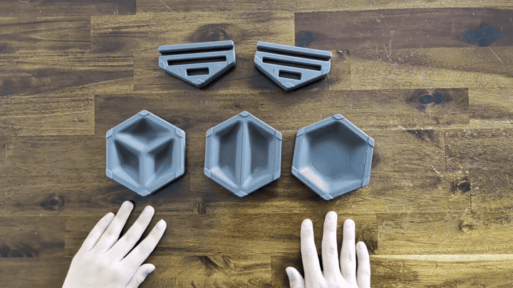
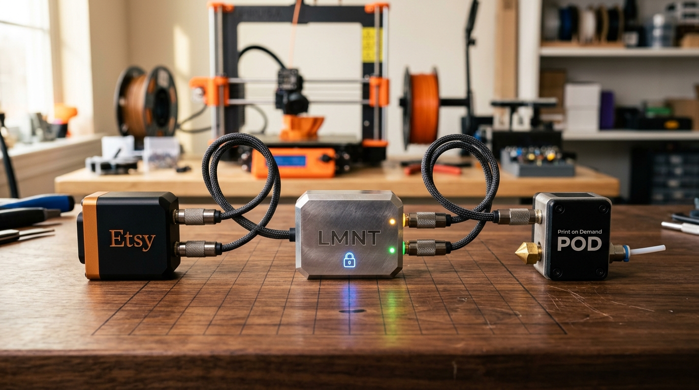
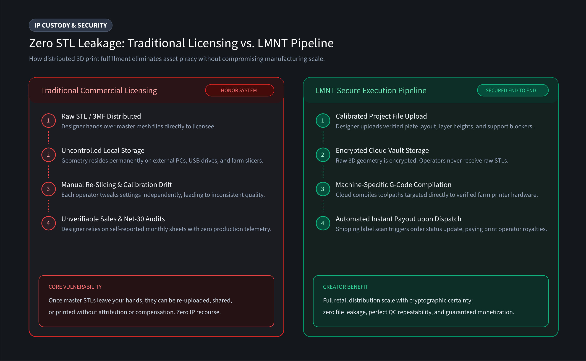

# Taking 3D Printed Products to Market (Part 5: From Product Staging to Automated Retail)

In Parts 1 through 4, I covered the licensing charter, magnet sourcing, slicing calibration, and the unit economics for the Hexstora tabletop organizer pilot.

Today, I am crossing the final hurdle before launch: **turning the 3D printed parts into compelling retail listings and connecting an Etsy store to a print-on-demand service** for automated sales processing and delivery.

If you think designing the CAD model and tuning slicing parameters is where the work ends, you may not be prepared for the additional work required to get your product "listing-ready."

> **TL;DR:** Etsy buyers want authentic proof of craftsmanship. Pre-launch retail prep (product photos, editing, writing product descriptions) added another 6.5 hours of labor, pushing my total pre-launch investment to $617.50.

---

## 1. It's Go Time: Etsy Listings and Launch Prep

To command a premium retail price for my 5-piece Starter Pack, the photography has to show a boutique level of craftsmanship and a compelling user experience.

Shoppers on Etsy want to see the product "in action." Showing how they would actually use the product helps create a personal connection in ways that a 3D render cannot. Get ready to spend some time taking quality photos and even a quick video of your product actually being used (Etsy's search algorithm heavily favors listings with video).

Here is my listing prep workflow:
- **The Setup:** I picked up an Amazon Basics photo lightbox a few years ago for about $100: it is nothing fancy, but helps light the product well, giving the photos a bit more of a professional feel. Definitely optional, but good lighting goes a long way. This is also a good opportunity to establish your visual style and aesthetic. Whatever you choose, stick with it for consistency!
- **The Staging:** I gathered real game props (polyhedral dice, sleeved cards, and game tokens) to visually communicate scale and function in 2 seconds of scrolling.
- **The Shoot:** Captured 30 to 40 photos from multiple angles including close-ups, underside magnet press-fits, stacked tiles, tiles assembled with game props added, and a quick video with hands demonstrating the tactile magnetic snap-fit.
- **Post-Processing:** Spent **3 hours** selecting, color-correcting, cropping, and organizing.

**Pro-Tip on Organization:** For more complicated multi-part products, or products with multiple listings (Starter Pack vs. individual pieces), keeping photos well organized along with associated product listing descriptions and pricing makes the whole publishing process much easier, especially if you plan on publishing to multiple marketplaces (Etsy & Shopify).

---

## 2. Connecting the Wires: Linking Etsy to a Secure Print-on-Demand Service

In Part 1, I set out to pressure-test two foundational questions:
1. **The Monetization Dilemma:** Can a designer monetize physical retail on Etsy without becoming a full-time box packer or surrendering raw STLs to the open internet?
2. **The Curated Retail Model:** Can a small print farm curate a storefront of licensed designs, produce them on demand, and build a sustainable business that fairly pays both the producer and the creator?

Let's take a closer look at the shop-floor production capability and financial realities. 

With my Hexstora Starter Pack (Etsy launch price: $59.99, ~5.5 hour print time per set), my local 3-printer fleet can produce 6 packs across a day shift into an overnight run (2 packs per printer daily). This assumes everything runs flawlessly: no nozzle clogs, auto-filament runout working, and zero bed adhesion failures.

If you protect your weekends and print 20 days a month, you can produce about **120 starter packs per month**, generating approximately **$2,621 in net profit**.

If you are a **product designer**, however, hitting that ceiling means that you are now locked in manufacturing mode. You will likely find that you have very little time left to design or prototype your next product. While $2,621 is a nice side hustle, it isn't enough to replace a full-time salary. 

Let's consider a few different commercialization paths:
- **Option 1: The Factory Scale-Up (Buy More Printers):** Buy 4 to 6 more machines, stock bulk filament, and become a full-time manufacturer. You capture 100% of the production profit, but you sacrifice your creative design time to become a machine mechanic, assembler, and shipping clerk.
- **Option 2: The Crowdfunding Sprint (The Kickstarter Model):** Package the digital STLs, sell commercial tiers, and run a high-energy 30-day crowdfunding campaign (exactly how Hexstora was launched). It delivers a fast upfront cash injection, but it is purely a **one-time revenue event** with zero recurring income. (In Part 7, I will do some math estimating the true labor and profit margins from a Kickstarter campaign vs. running continuous physical retail).
- **Option 3: The Direct-to-Retail / Print-on-Demand Hybrid:** Sell finished physical products on Etsy or Shopify. Fulfill baseline orders on your own 3 printers for maximum margin, and route overflow to an automated print-on-demand service. You trade a slice of production margin for completely hands-off scale, freeing up your time to build out a multi-product catalog.

I chose **Option 3: The Direct-to-Retail / Print-on-Demand Hybrid** for this experiment, and as I mentioned in Part 1, I decided to use the **LMNT Print-on-Demand service** so that I could fully explore how this hybrid model works in real life.

### Things to Consider When Evaluating a 3D Print-on-Demand Partner

If you are exploring 3D print-on-demand services to help scale your business, it is worth noting that different services are optimized for very different types of jobs. 

Large, centralized services excel at high-volume manufacturing by standardizing around a focused catalog of core materials, basic colors, and single-piece parts. For generic or high-throughput prints, that model is tough to beat.

When you are bringing a more complex or boutique product to market, however, here are a few key operational questions worth considering:

- **Boutique Flexibility & Assembly:** Can the partner handle products with hardware BOMs (like my 22 magnets) and specific aesthetic finishes, or are they strictly set up for single-part / high-volume prints?
- **Hybrid Fulfillment:** Are you forced into an all-or-nothing contract, or can you fulfill baseline orders on your own home machines for maximum profit and only route overflow to the network when volume spikes?
- **Source File Security:** Does the platform require uploading raw, unprotected STL files to third-party servers, or can jobs be produced without exposing your original source design files?

Here is how I use the LMNT Print-on-Demand service in my sales and fulfillment pipeline:
### A. The Pressure Relief Valve: Hybrid Local-First Fulfillment Routing
My setup enables a true hybrid manufacturing model:
- **Fulfill Locally First:** Baseline orders route directly to my own 3-printer fleet, allowing me to capture both the shop-floor labor wage ($12.50) and the print farm service margin ($6.83), keeping **$21.84 in net profit** per unit. If I go on vacation, or want to get heads down designing a new product, I can direct all fulfillment to print-on-demand partners.
- **Burst to the Network:** If a holiday rush or social post brings in 20 orders over a weekend, my 3-printer fleet hits its capacity wall. Instead of pausing listings on Etsy (which damages search ranking) or risking late-shipment strikes, overflow jobs can be routed to vetted LMNT partner farms running the identical, verified slicer profile.

### B. Eliminate Administrative Drag: Optimized Workflows & Reduced Manual Labor
A viable print-on-demand integration must reduce or eliminate clerical overhead. If an operator has to manually check Etsy notifications, download files, re-slice customer orders, copy/paste shipping addresses, and buy USPS labels by hand, that overhead burns 10 to 15 minutes per order. At my $25/hr living wage floor, that destroys $4 to $6 of profit before manufacturing even begins.
- **The LMNT Etsy Bridge:** When an Etsy customer purchases a Hexstora Starter Pack, LMNT automatically posts the order, BOM requirements (22 magnets), color variant, and customer shipping address directly into the print queue.
- **Push-Button Execution & Tracking Sync:** The print farm operator claims the job, sends it to an authorized printer, generates a pre-formatted shipping label with one click, and packs the finished trays using the standardized kit created in Part 2. The moment USPS scans the package, tracking details automatically push back to Etsy, marking the order shipped and protecting shop dispatch metrics.
- **Instant Payouts on Shipment (No Invoicing, No Waiting):** In traditional licensing or contract manufacturing, operators and designers wait Net-30 or Net-60 days for payouts and spend hours auditing monthly spreadsheets. With LMNT, the moment an order is scanned and marked shipped, payouts trigger automatically: the print farm gets its manufacturing payout ($39.48) and the designer receives their royalty ($23.51). No waiting, no invoicing, and no reconciliation headaches.

### C. Protecting the Model: Encrypted Source Files, Encrypted G-Code

In traditional commercial licensing, a designer hands over raw STL files and hopes the licensee honestly reports monthly sales. It is an unverified honor system.
- **Encrypted Models / Secure G-Code (No Leaked STLs):** LMNT does not distribute raw STL/3MF files to farm operators. The designer uploads their pre-configured project file (adaptive layer heights, support blockers, plate layout), and LMNT compiles machine-specific instructions directly for the operator's authorized printer. The operator receives everything needed to print flawlessly, while the designer's source geometry stays completely encrypted and private.

---

## 3. Part 5 Time & Sunk Cost Tracker

Here is the honest accounting of retail staging and listing setup:

- **Part 5 Hands-On Labor:**
	- Lightbox setup, prop staging, and shooting 30+ photos: **1.5 hrs**
	- Photo culling, color grading, cropping, and asset organization: **3.0 hrs**
	- Copywriting, SEO tag optimization, and webhook mapping: **2.0 hrs**
	- **Part 5 Total Labor:** **6.5 hours** (*$162.50 value at $25/hr floor*)

- **Running Series Total:** **$142.50 cash expenses** *(including $100 commercial license)* + **$475.00 labor value** *(19.0 hrs total @ $25/hr floor)* = **$617.50 Total Pre-Launch Investment**

Before my very first customer order arrives, I have invested over **$600 in real cash and labor value** to get this product to market.

---

## Field Notes for Designers & Print Farms

- **For Designers & Creators:** 
	- **Your time is your equity:** Maxing out 3 printers on 120 units a month brings in ~$2,600/month, but leaves zero time to prototype product #2, #3, or #4. Sustainable creator income comes from building a catalog of products with hands-off fulfillment, not running a single machine farm to exhaustion.
	- **True IP custody:** Choosing a secure print-on-demand service means you never surrender raw STL/STEP files to third parties. Encrypted print-time execution allows global production partners to fulfill orders under your exact specifications with zero risk of asset leakage or unauthorized redistribution.
- **For Print Farm Operators:** 
	- **Eliminating administrative drag:** Ingesting pre-configured, print-ready projects with auto-generated shipping labels and instant payouts upon shipment turns print fulfillment into a push-button workflow, giving you more time to focus on print efficiency, machine uptime, and print quality.

---

**Discussion Question:** For those who sell physical prints on Etsy or Shopify, how much time do you spend on photography and image editing compared to CAD modeling, and do you use renders or real camera shots?
