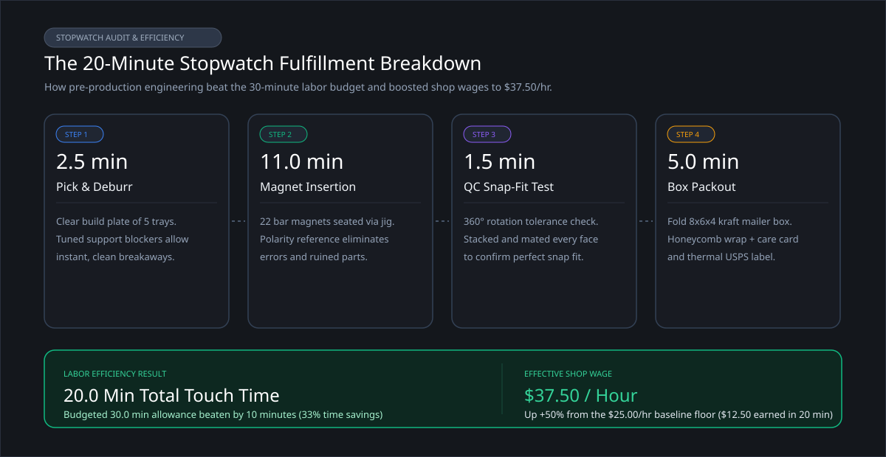
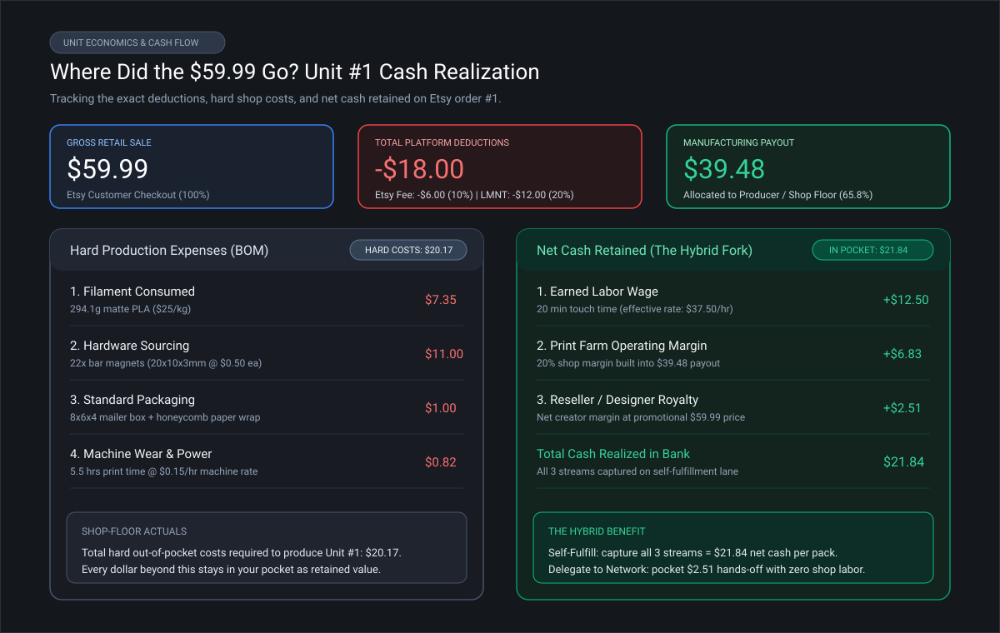

# Taking 3D Printed Products to Market (Part 6: First Real Order and Packout)

In Parts 1 through 5, I progressed from pledging a $100 commercial Kickstarter license to dialing in slicer settings, designing an assembly jig, modeling unit economics, and connecting my Etsy store to the LMNT print-on-demand platform.

Then, the notification chimed: **my first paid retail order on Etsy landed for the Hexstora Starter Pack.**

Most case studies treat order fulfillment as a simple victory lap: "Look, I made a sale!" But for anyone trying to build a sustainable business, order #1 is the **moment of truth**. It is where all of the theoretical spreadsheet math makes contact with shop-floor reality.

Did my 30-minute labor budget hold up? Did the 22 magnets turn into an assembly nightmare? Did clerical administrative drag quietly wipe out my profits before the first layer even went down?

Here is the breakdown of what happened when an order came through the door, tracking every minute of labor, every gram of filament, and the exact dollars retained.

---

## 1. The Silent Margin Killer: Eliminating Administrative Friction

Most 3D printing entrepreneurs focus exclusively on slicer speed and filament cost. In reality, it is a race to get the product processed and to the post office as you rush out the door to your day job, or bring the kids to school! 

Consider the typical manual routine when an Etsy order comes in:
1. Log into Etsy and download customer shipping info.
2. Manually purchase postage on a third-party shipping tool.
3. Find the product's source 3MF project on your computer, validate slicer settings.
4. Slice, Print, post-process cleanup, assemble.
5. Pack the box, copy the tracking number from your shipping label, and paste it back into Etsy to complete the order.

If that clerical shuffle takes 10 to 15 minutes per order, you burn **$4.00 to $6.00 in human labor value** before melting a single gram of plastic. On a single $19.99 tray with an $8 to $10 production cost, administrative drag can really eat into your profit margin.

Here is how the automated Etsy-to-LMNT bridge helped simplify administrative tasks on my first order:

- **Instant Ingestion:** The moment the customer checked out for the **Hexstora Starter Pack 1 (Matte Charcoal)**, within seconds Etsy's bridge sent the order directly into my LMNT shop dashboard.
- **Automated BOM & Spec Mapping:** The job arrived pre-configured with the exact production spec:
	- 3D Geometry: Full build plate of parts, preconfigured with support blockers, tuned adaptive layer heights, and optimized part orientation (292.9g estimated consumption)
	- Hardware BOM: 22x Bar Magnets (20x10x3mm)
	- Packaging Spec: Standard "Small" sized 8x6x4 mailer with protective honeycomb paper wrap
- **Two-Click Execution:** Because I run the hybrid local-first model, the order appeared in my local farm queue. Click #1 claimed the job. Click #2 sent the verified, machine-specific print job to one of my available printers.
- **One-Click Postage & Instant Sync:** Once the parts were packed, clicking "Fulfill" generated my USPS Ground Advantage label. The tracking number automatically synced back to Etsy, marking the order shipped and notifying the buyer instantly.

**Total Administrative Labor Spent:** **Less than 5 minutes.** 

---

## 2. The Stopwatch Test: How Pre-Production Protected the Margin

In Part 2, I spent 4.5 hours tuning adaptive layer heights, enabling support blockers, and orienting the parts for optimal printability. I also spent 2.5 hours designing a custom magnet alignment jig to help speed the assembly process. 

Was all that prep work necessary, or was it just over-engineering? The stopwatch gave me the answer.

### A. Print Execution & Material Actuals
Because my project print parameters were dialed in during pre-production, the print ran cleanly with zero warping, zero clogs, and zero bed-adhesion failures:

| Metric                                 | Pre-Production Budget | Shop-Floor Actual | Variance            |
| :------------------------------------- | :-------------------- | :---------------- | :------------------ |
| **Fleet Print Time**                   | 5h 30m (5.5 hrs)      | 5h 28m            | -2 minutes          |
| **Filament Consumed**                  | 292.9g ($7.32)        | 294.1g ($7.35)    | +1.2g (+$0.03)      |
| **Electricity & Machine Amortization** | $0.83 (@ $0.15/hr)    | $0.82             | -$0.01              |
| **Print Failures / Restarts**          | 0                     | 0                 | 0 (First-time pass) |

The $355 in R&D scrap logged in Part 2 paid its dividend here: zero scrap filament, zero failed plates, and zero missed shipping deadlines.

### B. The 22-Magnet Time-Sink vs. The Alignment Jig
The Starter Pack 1 bundle requires inserting **22 bar magnets** across 5 separate pieces. 

Inserting 22 press-fit magnets by hand without a system is an invitation to disaster: a single reversed magnet repels adjacent modular trays, ruining the piece and forcing you to gouge out the pocket with a knife, toss the part in the trash, and re-print.

Here is how my alignment jig performed:
- **Bed Clearing & Support Removal (5 trays):** 2.5 minutes.
- **Magnet Press-Fitting (22 magnets):** 11.0 minutes. The reference magnet on the jig guaranteed that every pocket received the correct pole without checking polarities by hand. Each magnet seated with a single arbor-press squeeze.
- **QC Snap-Fit Tolerance Test:** 1.5 minutes. Stacked and rotated all 5 trays against each other. Every one snapped cleanly into place with zero repelling faces.
- **Total Assembly Labor:** **15.0 minutes** (averaging ~40 seconds per part, supports removed and de-burred).

### C. Standardized Order Packaging
Having my packaging materials pre-staged and standardized kept packing effortless:
- Folded the 8x6x4 mailer box, wrapped each tray in kraft honeycomb paper, and added the care insert: 5.0 minutes ($1.00 packaging material cost).
- Attached the shipping label and sealed the box: included in the 5-minute packing window.

**Total Human Touch Time:** **20.0 minutes total** (10 minutes faster than my 30-minute labor budget). 

By beating my 30-minute allowance, my effective shop-floor wage rose from the $25.00/hr budget floor to an actual **$37.50/hour**.

---

## 3. Where Did the $59.99 Go? Proving the Hybrid Fork in Real Life

Here is the exact financial realization for Starter Pack #1:

| Item / Transaction Component       | Amount     | % of Retail | Destination / Purpose                                                         |
| :--------------------------------- | :--------- | :---------- | :---------------------------------------------------------------------------- |
| **Gross Retail Sale**              | **$59.99** | 100.0%      | Customer checkout price on Etsy                                               |
| **Etsy Marketplace Fees**          | -$6.00     | ~10.0%      | Etsy transaction (6.5%), payment processing (3% + $0.25), and listing ($0.20) |
| **LMNT Platform Fee**              | -$12.00    | 20.0%       | Cloud infrastructure, encrypted toolpath security, and automated API syncing  |
| **Printer Payout (Manufacturing)** | -$39.48    | 65.8%       | Covers hard production costs, direct labor, and farm profit margin            |
| **Reseller / Designer Royalty**    | **$2.51**  | 4.2%        | Net royalty earned per bundle at $59.99 promotional launch pricing            |

### What Did I Actually Put in My Pocket?

Because I fulfilled this first order on my own 3-printer fleet, I captured **both the manufacturing payout and the retail royalty**:

1. **Earned Labor Wage:** $12.50 (budgeted for 30 min of labor; completed in 20 min).
2. **Print Farm Profit Margin:** $6.83 (the 20% operating margin built into the $39.48 printer payout).
3. **Reseller Royalty:** $2.51 (my net margin on the listing).

- **Hard Out-of-Pocket Expenses:**
	- Filament (294.1g): $7.35
	- 22 Magnets: $11.00
	- Packaging & Mailer Box: $1.00
	- Machine wear & power (5.5 hrs): $0.82
	- **Total Hard Out-of-Pocket Costs:** **$20.17**

- **Total Net Cash Retained in My Pocket:** **$21.84** per Starter Pack.

### The Power of the Hybrid Model in Practice
This is where the theoretical promise of LMNT becomes a practical reality for creators:

- **Path A (In-House Fulfillment):** If you have machine capacity and want extra income, fulfill locally. Spend 20 minutes of shop time and pocket **$21.84 in cash**.
- **Path B (The Pure Designer):** If your printers are busy, you are on vacation, or you want to spend your week designing your next product, click "Delegate to Network." An authorized partner farm handles the printing, magnets, and packing, and you pocket the **$2.51 royalty** completely hands-off.

Proving that this fork functions smoothly on live orders means creators never have to choose between abandoning physical retail or becoming full-time factory workers.

---

## 4. The Payback Ledger: Chipping Away at Pre-Launch Sunk Costs

In Part 5, my pre-launch investment stood at **$142.50 in out-of-pocket cash** ($100 Kickstarter commercial license + $42.50 test hardware) and **$475.00 in labor value** (19.0 hours @ $25/hr floor), totaling **$617.50**.

By choosing the self-fulfillment lane for my pilot, I captured the full **$21.84 in net cash** ($12.50 earned labor wage + $6.83 farm margin + $2.51 royalty) directly into my bank account. 

Unit #1 marks the turning point where the red ink stops growing and the balance starts paying down:

- **Pre-Launch Sunk Cost Balance:** $617.50
- **Net Cash Retained on Unit #1:** -$21.84
- **Remaining Sunk Cost Balance:** **$595.66** ($120.66 cash remaining / $475.00 labor remaining)

At my promotional $59.99 launch price on the self-fulfillment path:
- **7 sales** fully pay off the initial $142.50 out-of-pocket cash investment.
- **29 sales** completely pay off every dollar of pre-launch engineering labor and cash ($617.50 total).

Once I cross unit #29, all pre-production R&D is completely amortized, and every subsequent bundle sold puts **$21.84 in profit and wages** directly into the shop.

---

## 5. Part 6 Time & Labor Tracker

Here is the honest accounting of fulfilling live retail order #1:

- **Part 6 Hands-On Labor:**
	- Queue dispatch, machine staging, and plate harvest: 5.0 min
	- Post-production assembly and magnet insertion: 11.0 min
	- QC inspection and snap-fit tolerance check: 1.5 min
	- Box fold, honeycomb wrap, packout, and label application: 5.0 min
	- Drop-off at USPS postal counter: 10.0 min
	- **Total Part 6 Labor:** **32.5 minutes (~0.54 hrs)** (*$13.54 value at $25/hr floor*)

- **Running Series Total:** **$142.50 cash expenses** *(pre-launch R&D)* + **$488.54 labor value** *(19.54 hrs total @ $25/hr floor)* = **$631.04 Total Investment Logged to Date**
- **Total Revenue Ingested:** $59.99
- **Net Cash Realized in Bank:** **$21.84**

---

## Field Notes for Designers & Print Farms

- **For Designers & Creators:** 
	- **Automated shipping updates protect your shop rating:** Etsy penalizes stores with late shipping times or manual tracking delays. Having tracking numbers sync to the marketplace automatically the second a label prints protects your store's algorithmic visibility without manual effort.
	- **The mental relief of print-on-demand capacity:** Knowing that you can fulfill locally when you want the extra cash ($21.84), but can hand off overflow to the network during busy weeks without surrendering your STL files, is the only realistic way to build a multi-product catalog.
- **For Print Farm Operators:** 
	- **Assembly jigs are not optional:** The 11 minutes spent inserting 22 magnets with my polarity jig was the difference between a smooth 20-minute packout and an hour-long disaster of reversed magnets and ruined prints. Never accept a hardware-assembly SKU into your print farm without an assembly jig.
	- **Standardize box sizing:** Keeping 8x6x4 mailers and honeycomb wrap pre-stocked at your packing bench eliminated hunting for cardboard or custom cutting boxes, keeping packing labor under 5 minutes.

---

**Discussion Question:** For those fulfilling orders on Etsy or Shopify, what is your biggest bottleneck between print completion and carrier drop-off: magnet assembly, boxing, or manual label generation?
