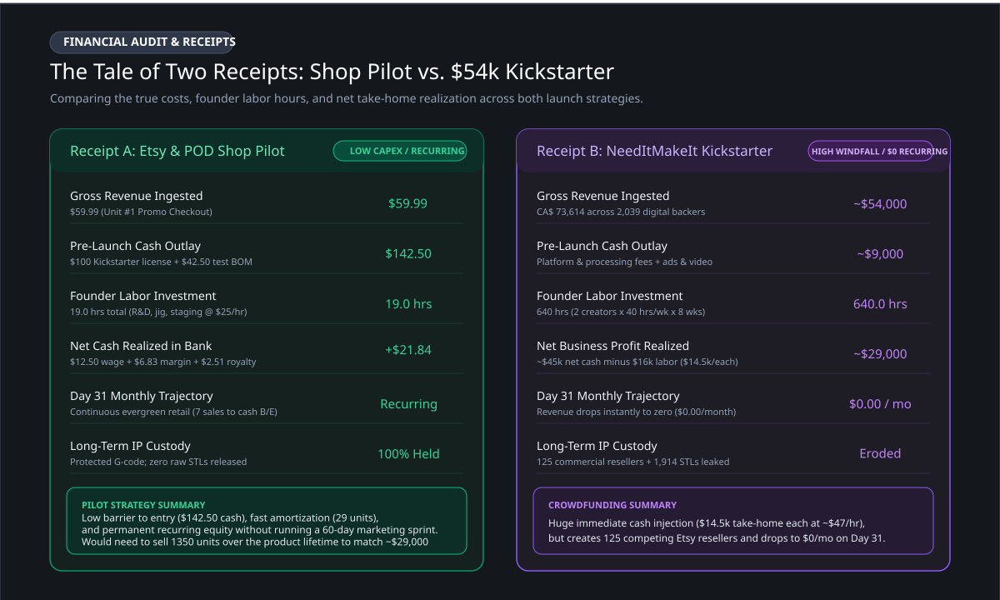
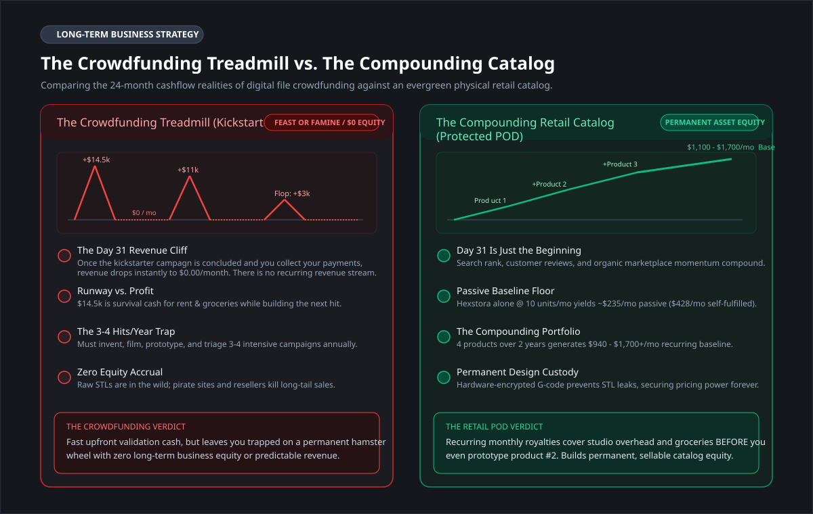
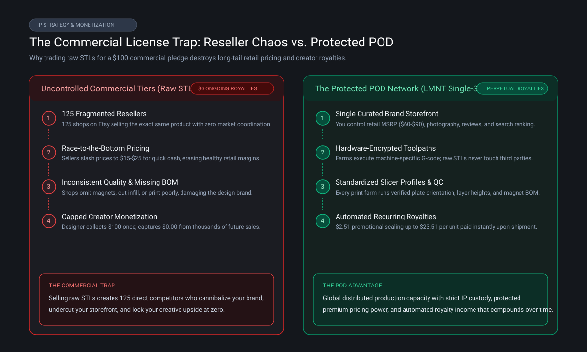

# Taking 3D Printed Products to Market (Part 7: Retail vs. Kickstarter with Real Receipts)

Over the past six posts, I documented the complete journey of taking a commercially licensed 3D product (NeedItMakeIt's Hexstora tabletop game organizer) from a Kickstarter pledge into a live, automated retail product on Etsy.

I tracked every step with receipts:
- Slicer tuning and custom polarity jig engineering in Part 2
- Sunk cost tracking and the solo fleet bottleneck in Part 3
- True shop-floor costs, BOM baselines, and pricing reality checks in Part 4
- Photography staging and automated store-to-farm bridges in Part 5
- First live order execution, shop-floor production metrics, and cash realizations in Part 6

Now that my pilot has completed its initial live fulfillment run, it is time to address the core dilemma I posed in Part 1:

**Is continuous physical retail worth the operational grind, or should 3D creators just stick to one-time Kickstarter crowdfunding campaigns?**

To answer that honestly, I do not need theoretical speculation. I have the actual receipts from both sides of the table.

---

## 1. The Tale of Two Receipts: My $617 Pilot vs. Their $54k Kickstarter

Let's put the numbers head-to-head.

### Receipt A: My Etsy & Print-on-Demand Pilot (Rolled Up)
Across Parts 1 through 6, I logged every dollar and every minute required to launch Hexstora as an automated physical product:

- **Total Pre-Launch Investment:** **$617.50**
	- **Cash Out-of-Pocket:** $142.50 ($100 Kickstarter commercial license + $42.50 hardware/magnet samples).
	- **Hands-On Labor:** 19.0 hours across print tuning, magnet jig, financial modeling, photography, and store setup ($475.00 value at my $25/hr floor).
- **Unit #1 Realization ($59.99 Promotional Sale):** **$21.84 net cash retained**
	- Customer paid $59.99 on Etsy.
	- Minus platform & marketplace fees: -$18.00 (Etsy ~$6.00 + LMNT $12.00).
	- Minus hard production costs: -$20.17 (filament $7.35 + 22 magnets $11.00 + box $1.00 + machine wear $0.82).
	- Net cash in bank: **$21.84** (spending 20 minutes of shop labor).
- **The Payback Horizon:** 7 sales to break even on cash out-of-pocket ($120.66 deficit remaining); 29 sales to fully amortize all pre-launch R&D.

---

### Receipt B: NeedItMakeIt's Kickstarter Campaign (Rolled Up)
Now let's take a look at the campaign numbers, and some estimates, from Hexstora's original Kickstarter:

- **Gross Revenue Raised:** **CA$ 73,614 (~$54,000 USD)** across 2,039 backers.
	- 1,914 personal-use backers (~CA$ 61,114) buying digital STLs.
	- 125 commercial license backers (CA$ 12,500) at CA$ 100 each.
- **Platform & Direct Campaign Expenses:** **~$9,000 USD**
	- Platform & payment processing fees (8 to 10%): ~$5,000.
	- Direct campaign expenses (video production, prototyping filament, magnets, modest ads): ~$4,000.
- **Founder Labor Audit ($25/hr Floor):** **$16,000 value**
	- 2 creators working 40 hrs/week for 2 months (8 weeks) = 640 person-hours.
- **Net True Business Profit:** **~$29,000 USD**
	- ~$45,000 net cash minus $16,000 founder labor = **~$29,000 profit** (split between two creators = **~$14,500 each**, an effective wage of ~$47/hour for a 60-day sprint).

---

### The Punchline: Does Kickstarter Blow Retail Out of the Water?

Compare those two outcomes:
- In a 60-day sprint, the Kickstarter campaign generated **~$29,000 in clean take-home profit**.
- Meanwhile, my live Etsy store generated **$21.84** on Unit #1.

Let's do the math on what it takes for retail sales to catch up:

- **Via Passive Royalties ($23.51/unit at $89.99 MSRP):** 
  To match that $29,000 Kickstarter payday, you would need to sell **1,233 Starter Packs** on Etsy. At a steady, respectable run-rate of 15 bundles a month, it would take **over 82 months (nearly 7 years)** of continuous retail sales to match what Kickstarter delivered in 60 days. Even at an aggressive 30 sales a month, you are looking at **over 3.5 years**.
- **Via In-House Shop Fulfillment ($42.84 net cash at MSRP):** 
  Even if you assemble and pack every order yourself in your garage at full retail price, you still need **677 sales (over 3.7 years at 15 units/month)**, requiring over 225 hours of hands-on packing labor.

Looking at that disparity, the immediate, honest question is: **why wouldn't a designer just take 7 years of profit in 60 days and run?** 

On paper, continuous retail POD sounds like a slow-motion grind compared to crowdfunding. And that is exactly what is so alluring about a Kickstarter style product launch. 

But when you look past the initial check, that $29,000 payday comes with two important cashflow caveats.

---

## 2. The Two Hidden Gotchas of the Crowdfunding Product Launch

First, an important clarification: **this is not a critique of Kickstarter.** Crowdfunding is an incredible mechanism to validate demand and generate upfront revenue.

However, treating digital file Kickstarters as a sustainable, standalone business model introduces two important challenges:

### Trap 1: The Day 31 Cliff (The Crowdfunding Treadmill)
That $14,500 per creator is a solid payday, but here is the catch: **what happens on Day 31?**

That cash is not disposable bonus profit: it is the financial runway that has to cover living expenses (rent, groceries, studio overhead) while you design, prototype, and market your next project. Depending on your situation, $14,500 can buy a few months of breathing room before the bank account runs dry.

The moment the campaign closes, your revenue stream drops immediately to **$0.00/month**. 

To earn your next dollar, you must jump straight back onto the **crowdfunding treadmill**: invent another hit concept from scratch, shoot another pitch video, and run another intensive 60-day sprint. To sustain a full-time living, you need **3 to 4 viral hit campaigns every single year**.

If you suffer designer burnout, if campaign #3 flops, or if an algorithm shift hurts your reach, your income vanishes overnight. You build **zero residual catalog equity**.

### Trap 2: The Commercial License Dilemma
NeedItMakeIt deliberately chose not to sell physical prints. To get a cut of retail product demand without running a factory, they sold commercial license tiers allowing third parties to print and sell the product.

While collecting CA$ 12,500 upfront for commercial licensing looks great on paper, emailing raw STLs to 125 independent print shops created **125 uncoordinated resellers competing against each other on Etsy**. 

While we cannot track every transaction across 125 independent storefronts, here is what predicted (and already surfaced on Etsy):
- **Uncoordinated pricing:** Independent sellers set retail prices based on their immediate cashflow needs, often optimizing for quick short-term sales over sustainable margins.
- **Inconsistent product execution:** Print quality, consistency, and hardware assembly vary across shops, with some listings even omitting magnets to cut costs and undercut competitors.
- **Capped creator upside:** The designer's return is permanently locked at that initial $100 pledge, earning **$0.00 in ongoing royalties** and essentially betting against the thousands of long-tail retail sales their design might generate.
- **File leakage and margin erosion:** Distributing unsecured STLs makes file sharing across pirate channels virtually inevitable, eroding the market share and pricing power of the legitimate resellers who paid for a commercial license.

---

## 3. The Strategic Verdict: Choose Your Business Model

When designers look at these revenue streams, it is tempting to try and mash the two models together: run an STL file-sharing campaign on Kickstarter to generate cash quickly, and then attempt to launch that same product on Etsy with print-on-demand.

As tempting as it sounds: **this hybrid approach carries serious commercial risk for your retail plans.** 

The moment raw STLs are distributed to thousands of backers, your raw design files are in the wild. You face a high likelihood of uncontrolled print shops and hobbyists popping up on Etsy, selling raw prints for $15 and eroding your pricing power before your official storefront can even establish traction.

Instead of trying to straddle both worlds, creators who want to build a physical product business have two clear, pragmatic paths:

### Path 1: The Crowdfunded Launchpad (If You Have the Energy)
- **Who It Is For:** Designers who have the time, marketing stamina, and community reach to run an intensive 60-day crowdfunding campaign.
- **The Play:** Launch on Kickstarter to capture that upfront personal-use digital blueprint revenue ($30k to $60k) from 3D printer enthusiasts. This injects upfront capital to fund your early CAD design time, test filament, sample hardware, and assembly jigs.
- **The Non-Negotiable Rule:** **Never sell commercial license tiers.** Do not create 125 Etsy competitors for a quick $100 check.
- **The Sober Reality:** Accept that once 1,900 hobbyists have your STL, file leakage in the maker community is inevitable. 
- **The Retail Move:** Establish your own official, premium retail storefront on Etsy for the 98% of consumers who do not own 3D printers. 
- **The POD Pressure Relief Valve:** Fulfill orders locally when you have spare machine time to capture maximum cash in your pocket ($21 to $42 per bundle). When order volume surges or your printers are tied up, hit "Delegate" and let the POD network absorb the manufacturing spike so your living room never turns into an overwhelming cardboard warehouse.
- **The Trade-off:** You still have to sell > 410 retail units (about 35 every month) to make up for the 125 commercial use licenses: after that it is gravy. Can you pull it off?

### Path 2: The Direct-to-Retail Purist (Skip the Circus Altogether)
- **Who It Is For:** Designers who want to build an enduring physical product business without the exhausting 60-day crowdfunding dog-and-pony show.
- **The Play:** Skip Kickstarter completely. No video shoots, no pre-launch ad spend, no comment triage, and no backer survey headaches.
- **Total IP Custody from Day 1:** Your CAD models and source STLs never touch the open internet. Zero file leaks, zero copycats (let them spend the energy to reverse engineer), and zero price erosion.
- **The Bootstrap Launch:** Launch directly on Etsy or Shopify. Focus 100% of your creative energy on great product photography, marketplace SEO, and customer reviews. Fulfill early orders on your 2 or 3 workshop printers, pocketing healthy margins while you dial in assembly jigs and packaging.
- **Scale Without Capex:** As organic search rank builds and sales follow that parabolic curve, turn on POD as your automated scaling engine and pressure relief valve. You expand into a multi-product catalog that pays recurring royalties year after year, without ever buying a 20-printer warehouse or taping boxes at 2 AM.
- **The Trade-off:** It is a longer road to sustainability, and you really have to focus on building depth in your catalog, along with brand recognition. It may be a side-hustle for longer than expected!

### So, What Kind of Business Are You Building?

Both paths are completely valid, but they force an honest question for you to consider: **what kind of business are you actually trying to build?**

If you choose the Kickstarter route and sell raw STLs, you can capture an upfront cash windfall from 3D printing enthusiasts. That is a great way to fund early CAD development or pay immediate bills. But you have to accept the trade-off: **you probably are not building a sustainable, long-term catalog to support retail sales.** Once raw STLs are out in the wild, it is simply too easy for someone to clone your geometry, share your files, or undercut your storefront on Etsy, permanently impacting your long-tail retail sales opportunities.

If your goal is to build an enduring physical product brand, that is where the retail print-on-demand model shines. 

It is not an overnight jackpot: it is an honest, long-term journey. Physical products naturally follow a realistic lifecycle (a parabolic sales curve over months to years). You might get an initial launch surge, followed by a steady ramp as your photography, customer reviews, and marketplace search rankings build, eventually peaking and settling into a predictable, evergreen baseline.

Unlike a Kickstarter campaign, on Day 31 after a product launch, **your sales machine does not shut down.** 

Because your geometry remains protected and your production pipeline is dialed in, each product enters your expanding catalog:
- **Hands-Off Passive Royalties:** When an order arrives, you can delegate to a partner farm to handle the manufacturing and shipping, paying you a sustainable royalty (**$2.51 bare-bones launch, scaling up to $23.51 at full MSRP**) all without your direct involvement in production.
- **In-House Cash Capture:** During shop downtime, you can fulfill orders on your own small printer fleet in 20 minutes of touch time, pocketing **$21.84 to $42.84 in net cash** per bundle.
- **The Compounding Portfolio:** You do not need Hexstora to sell 100 units a month. If Hexstora sells a modest 10 units a month, that is ~$235/mo in passive royalties (or $428/mo in cash if self-fulfilled). Add three more specialized products to your catalog over the next two years performing similarly, and your portfolio generates **~$940/month in passive royalties** (or **over $1,700/mo** if you fulfill baseline orders at home).

That recurring catalog income pays your studio overhead and groceries *before* you even begin your next design. It turns 3D printing from an exhausting, feast-or-famine hamster wheel into a permanent, equity-building creative business.

---

## Field Notes for Designers & Print Farms

- **For Designers & Creators:** 
	- **Decide what business you are in:** Selling digital blueprints to 3D printer owners and selling finished products to retail consumers are two fundamentally different business models. Sharing raw STLs as a Kickstarter product erodes the pricing power required to succeed at physical retail.
	- **Your product must solve a high-value problem:** Physical 3D printing cannot compete against low-cost injection-molded commodity organizers. Focus on specialized, high-margin products where consumers happily pay $60 to $120+ because no mass-market alternative exists.
	- **Find a trusted manufacturing partner:** If your product requires hardware integration or manual assembly (like Hexstora's 22 magnets), do not expect random print shops to fulfill it on a whim. Find a dedicated, trusted print farm partner, provide them with assembly jigs and SOPs, and make them your preferred print-on-demand fulfiller so you can build a real business together. Keep the number of preferred partners to a minimum.
	- **Retain custody of your geometry:** True creator agency means never handing uncompiled, unprotected CAD or STL files to third-party contract manufacturers or uncontrolled commercial tiers.

- **For Print Farm Operators:** 
	- **Unattended machine time is your real margin:** Farms make money while printers run in the dark, not by standing at a workbench doing manual assembly. Prioritize jobs with high machine-to-labor ratios (like the 5.5-hour overnight batch plate from Part 2). Labor is your highest-cost variable: every minute of touch time must be accounted for.
	- **If you take on assembly, negotiate preferred fulfiller status:** Stocking bespoke hardware (specific magnets, screws, or other sugar) and training staff on custom assembly jigs is a real operational investment. Never take on that burden for casual, one-off spot orders. If you commit to stocking hardware and learning a complex assembly, negotiate with the designer to be their preferred print-on-demand fulfillment partner. You get predictable, recurring volume to amortize your inventory and training, while they get a trusted production arm.
	- **Standardized workflows protect your hourly rate:** For any product requiring hands-on touch, require or build dedicated assembly jigs, time your workflow with a stopwatch, and enforce minimum labor fees ($25+/hr). Never absorb assembly, hardware stocking, or custom packout as a free courtesy to win print volume.

---

**Discussion Question:** If you are an independent designer, which path appeals to you more: running high-speed Kickstarter launchpads, or skipping the crowdfunding circus to build an evergreen retail catalog with print-on-demand?
